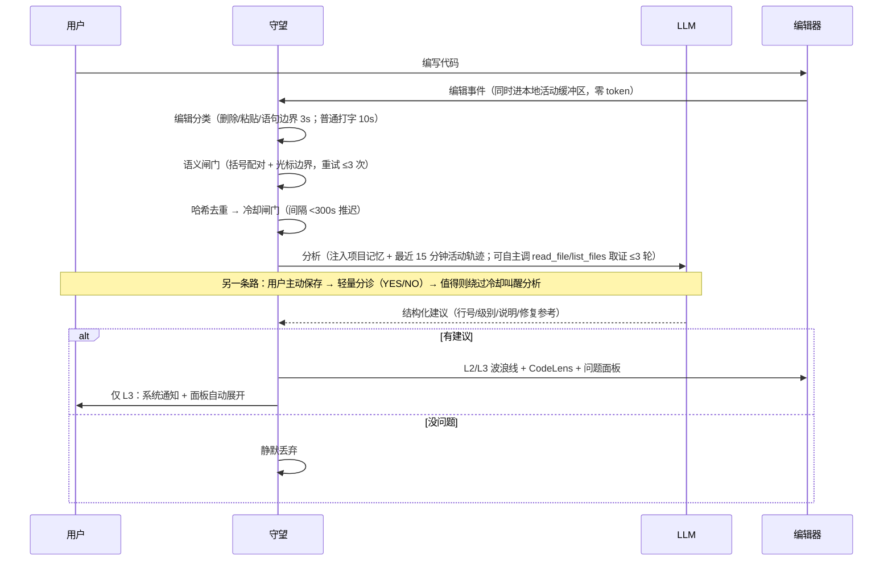
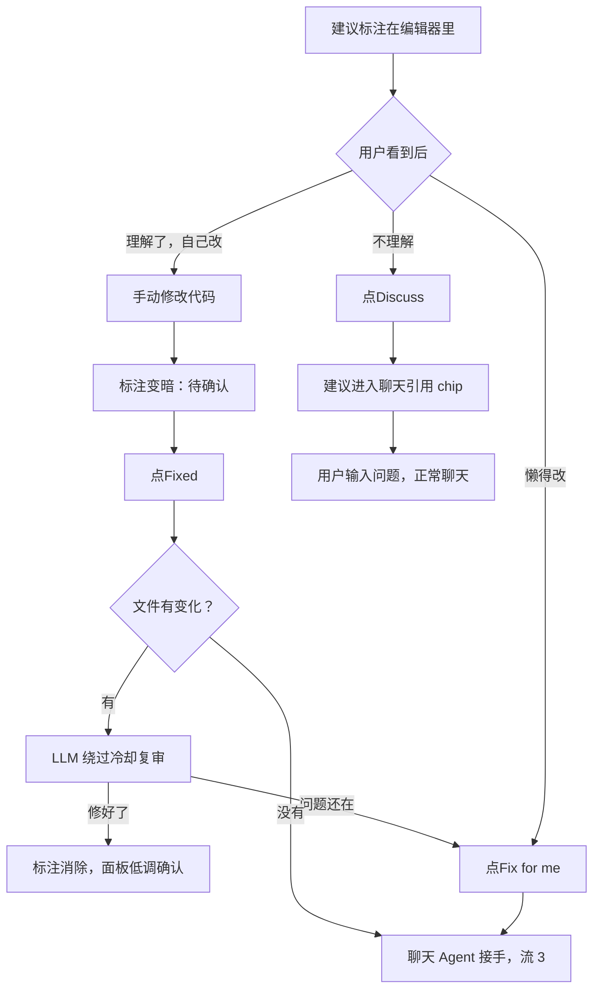
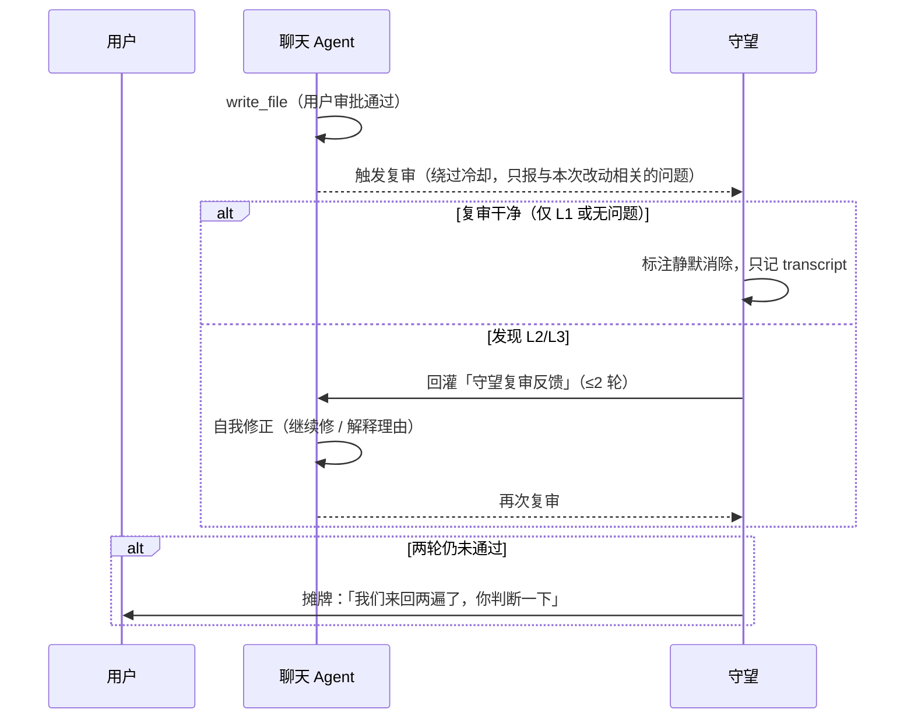
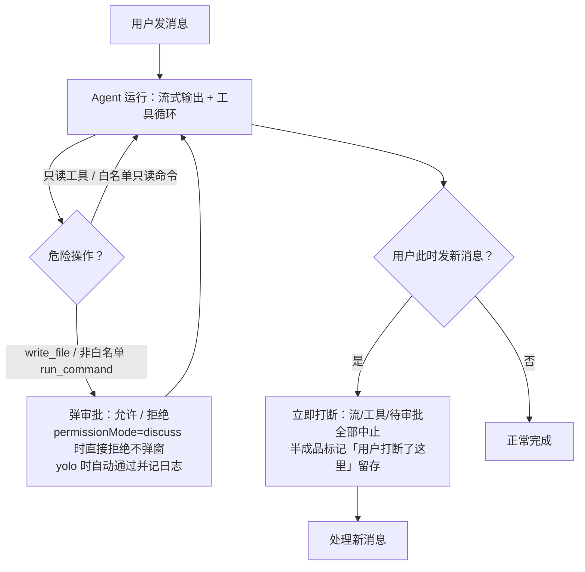
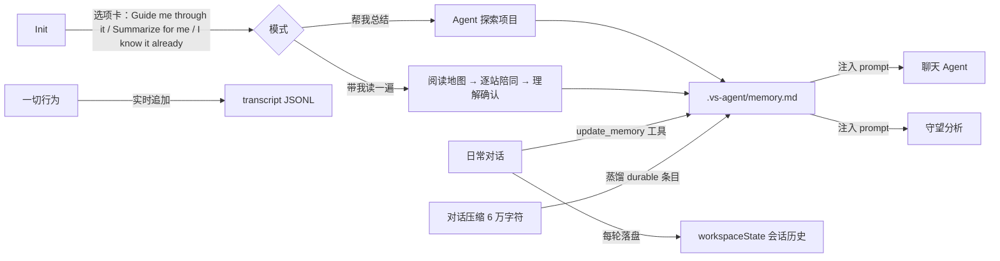

# 用户流（User Flows）

> 本文档描述 VS Agent **当前版本**的用户交互流，用 mermaid 表达。
> **维护约定**：每次改动交互行为后，必须同步更新本文档 + README.md + docs/ARCHITECTURE.md。

角色定义：

| 角色 | 是什么 |
| --- | --- |
| 用户 | 写代码的人，大部分时间只看编辑器，不看面板 |
| 守望（Observer） | companion 模块：被动观察、分级推送建议、复审 |
| 聊天 Agent | 对话与工具执行：讨论、改文件、跑命令 |
| 记忆 | 会话历史（workspaceState）+ 项目记忆（.vs-agent/memory.md）+ transcript |

设计总原则：**人的注意力是稀缺资源**。常态静默（L1、复审通过），弱打断走编辑器标注（L2），只有真正需要人判断时才上升到用户面前（L3 通知、复审两轮未过、审批请求）。聊天窗口是讨论的容器，不是发起交互的入口。

## 流 1：守望观察（AI 主动开口的主链路）

## 流 2：用户回应建议（核心交互闭环）

## 流 3：Agent 产出对账（内部闭环，原则上不打扰用户）

## 流 4：聊天与打断

## 流 5：记忆的生命周期

## 用户故事（User Stories）

按优先级排列，每条标注实现状态：

- ✅ 作为写代码的人，我希望 AI 在我停笔时主动给出建议，而不是我去问它
- ✅ 作为用户，我希望建议按严重程度分级呈现，小事不打扰、大事必打断
- ✅ 作为用户，我希望看到建议后一键「改好了 / 帮我改 / 讨论」，不用打字描述是哪条
- ✅ 作为用户，我希望 AI 改完的代码有另一个「眼睛」复审，通过后安静消失，不通过时它们自己先扯清楚，扯不清再找我
- ✅ 作为用户，我希望随时能打断 AI 的发言和动作，像跟真人说话一样
- ✅ 作为用户，我希望 AI 记得这个项目的约定和我们做过的决定，重开 VS Code 也不用重讲
- ✅ 作为用户，我希望第一次使用时 AI 能自己先熟悉项目（Init）
- ✅ 作为刚接手项目的人，我希望 AI 带我读一遍代码——给阅读地图、逐站陪同、验证我的理解，而不是替我读（Init选"Guide me through it"）
- ✅ 作为用户，我希望 AI 拿不准时能自己去读项目里的文件，而不是瞎猜
- ✅ 作为用户，我希望所有 AI 行为都能复盘（transcript），token 花了多少心里有数
- 🟡 作为用户，我希望 AI 理解我「这段时间在干什么」（工作焦点/意图跟踪），基于行为模式搭话——**一期已实现**（本地活动轨迹注入分析，跨文件视野）；**二期分诊已实现**（保存时轻量模型决定是否叫醒深度层）；「速记员」滚动总结工作焦点待做
- 🔲 作为用户，我希望可以告诉 AI「别再提这类建议」，它记住并遵守——**禁区分区已有，一键忽略未实现**
